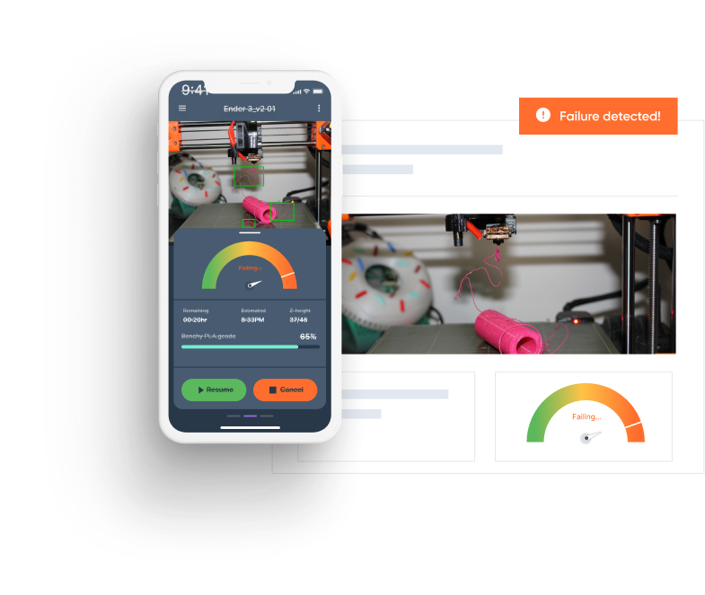

# Obico for OctoPrint

**AI failure detection, remote access and webcam streaming for OctoPrint.**

This OctoPrint plugin connects your printer to [Obico](https://www.obico.io/octoprint.html?utm_source=github&utm_medium=readme&utm_campaign=OctoPrint-Obico) (formerly The Spaghetti Detective). Once it's linked, Obico watches the print through your webcam, spots failures like spaghetti with AI, and pauses the print. You can also open your full OctoPrint from anywhere, without port forwarding.

<p align="center">
  
</p>

## What you get

- **AI failure detection** that pauses the print or alerts you when it sees a failure.
- **Remote access** to your full OctoPrint interface, and the Obico app for [iOS](https://apps.apple.com/us/app/the-spaghetti-detective/id1540646623) and [Android](https://play.google.com/store/apps/details?id=com.thespaghettidetective.android).
- **Webcam streaming**, including multiple cameras.
- **Print notifications** by email, Telegram, Discord, Pushover and more.

## Install

Search for "Obico" in OctoPrint's [Plugin Manager](https://docs.octoprint.org/en/master/bundledplugins/pluginmanager.html), or install it from this URL:

    https://github.com/TheSpaghettiDetective/OctoPrint-Obico/archive/master.zip

Then follow the [setup guide](https://www.obico.io/docs/user-guides/octoprint-plugin-setup/?utm_source=github&utm_medium=readme&utm_campaign=OctoPrint-Obico) to link the plugin. It links to Obico Cloud by default ([sign up](https://app.obico.io/accounts/signup/?utm_source=github&utm_medium=readme&utm_campaign=OctoPrint-Obico)), or to your own [self-hosted Obico Server](https://github.com/TheSpaghettiDetective/obico-server) ([how to point the plugin at it](https://www.obico.io/docs/server-guides/configure-octoprint-plugin/?utm_source=github&utm_medium=readme&utm_campaign=OctoPrint-Obico)).

Questions? Ask on [Discord](https://obico.io/discord).

# Plugin Development

## Running the plugin locally

```bash
docker compose up -d
```

Will start a series of containers that support the plugin (eg mock video streaming) as well as an octoprint container for python2 and python3. However, to enable interactive debugging the plugin containers are not running the plugins yet.

In another terminal:

To install the plugin in the container run:
```bash
docker compose exec {op/op_python2} pip3 install -e /app
```

Then to start octoprint (and by extension the plugin) run:

```bash
docker compose exec {op/op_python2} ./start.sh
```

## License

AGPL-3.0.
